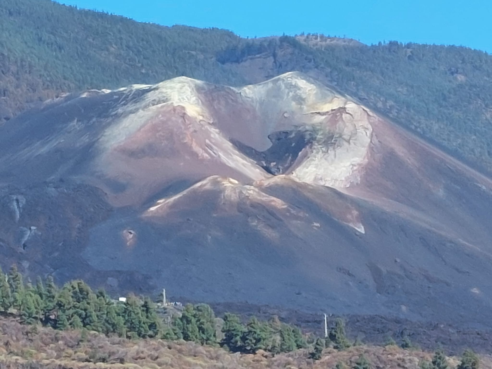

{fig-align="center" width="100%"}

## Sobre mí

**María Charco** es Científica Titular en el Instituto de Geociencias [(IGEO)](https://www.igeo.ucm-csic.es/), centro mixto del Consejo Superior de Investigaciones Científicas [(CSIC)](https://www.csic.es/es) y de la Universidad Complutense de Madrid [(UCM)](https://www.ucm.es/). Su formación en Matemáticas y especialización en Geodesia,culminada con una tesis doctoral (Premio Extraordinario 2003/2004) sobre modelización de deformaciones y variaciones de gravedad en áreas volcánicas, han orientado su carrera investigadora hacia la Geodesia Volcánica. En este campo ha trabajado en el desarrollo de modelos numéricos avanzado, integrando datos de teledetección a gran escala —incluidos GPS, InSAR diferencial y datos gravimétricos— para analizar e interpretar la deformación de la superficie terrestre. A través de su investigación, ha contribuido en la mejora de modelos computacionales físicamente coherentes y geofísicamente significativos que permiten
profundizar en la comprensión de riesgos volcánicos. Además, su experiencia y formación
matemática en el ámbito de la modelización numérica avanzada y de problemas inversos han
dado lugar a valiosas colaboraciones tanto en el campo de la Geodesia Volcánica como en otros campos de las Ciencias de la Tierra como el de la modelización de la estructura y dinámica de la litosfera. Cuenta con 38 contribuciones científicas considerando artículos, libros y capítulos de libro, informes y software en abierto, además de numerosas aportaciones a congresos destacando dos invitaciones como conferenciante plenaria en workshop  nternacionales. Ha participado en un total de 38 proyectos de investigación, siendo IP o Co-IP en cinco de ellos y ha colaborado en otros
financiados por la UE, ESA o protección civil italiana. Tiene reconocidos tres sexenios y tres
quinquenios de investigación.
Su investigación tiene también impacto social y mediático, con presencia en medios nacionales. Mantiene un fuerte compromiso con la divulgación científica y la transferencia de conocimiento, participando en cursos, publicaciones y eventos, y ha formado parte de los ponente de un itinerario Cicerón 2026 del Hub Converge del CSIC. Ha colaborado activamente con el Instituto Geográfico Nacional durante las crisis volcánicas
de El Hierro y La Palma, contribuyendo con asesoramiento científico y formación de personal.
Asimismo, ha participado en iniciativas estratégicas como el reto CSIC 2030 [“White Paper: Dynamic Earth: probing the past, preparing for the future”](http://libros.csic.es/product_info.php?products_id=1525), en evaluaciones científicas nacionales e internacionales (NSF, NERC, UE) y actualmente es miembro del Strategic Advisory Board
de [Destination Earth (UE)](https://destination-earth.eu/), asesorando en políticas digitales vinculadas a la modelización
geofísica aplicada a la mitigación de riesgos.

## Formación Académica

* **Licenciada en Ciencias Matemáticas**, Universidad Complutense de Madrid, 1997.
*  **Doctora en Ciencias Matemáticas (Premio Extraordinario)**, Universidad Complutense de Madrid, Facultad de Ciencias Matemáticas, UCM (Curso 2003-2004).
  
  ## Situación Profesional 

* 2009-sigue: **Científica Titular de OPI**, [Geodinámica y Observación de la Tierra](https://www.igeo.ucm-csic.es/investigacion/departamentos/dinamica-terrestre-y-observacion-de-la-tierra/) (IGEO).
* 2007-2009: **Profesora Titular de Universidad** Interina de la E.U. de  Arquitectura Técnica de la Universidad Politécnica de Madrid [(UPM)](https://www.upm.es/).
* 2003-2007: **Ayudante de Facultad LRU** en la Facultad de Ciencias Matemáticas de la UCM.
* 1999-2003: **Becaria Formación de Personal Investigador (FPI)** de la UCM, Facultad de Ciencias Matemáticas, UCM.
* 1999: **Personal Contratado Laboral**, nivel licenciado, Instituto de Astronomía y Geodesia (IAG), CSIC-UCM. 
