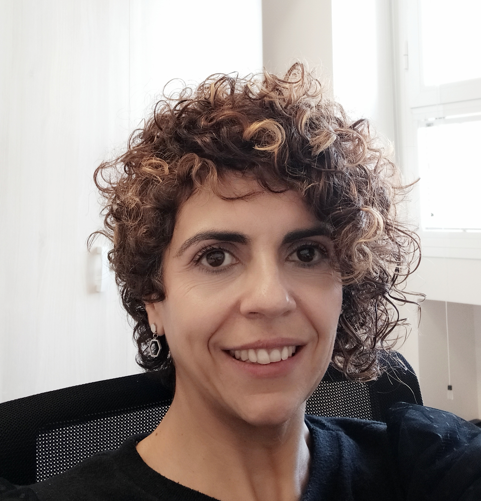
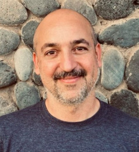
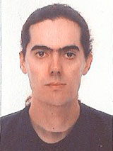
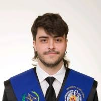
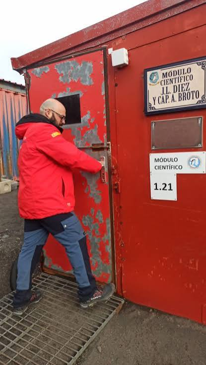
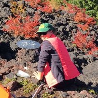
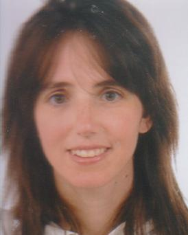
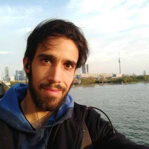

```{=html}
<style>
.grid-equipo {
  display: grid;
  grid-template-columns: repeat(auto-fill, minmax(200px, 1fr));
  gap: 2rem;
  margin-top: 1.5rem;
  margin-bottom: 2rem;
}

.tarjeta-persona {
  text-align: center;
}

.tarjeta-persona img {
  width: 160px;
  height: 160px;
  object-fit: cover;
  border-radius: 50%;
  margin-bottom: 0.75rem;
  border: 3px solid #ddd;
}

.tarjeta-persona h4 {
  margin: 0.25rem 0;
  font-size: 1rem;
}

.tarjeta-persona p {
  font-size: 0.85rem;
  color: #666;
  margin: 0.2rem 0;
}

.tarjeta-persona .enlaces a {
  margin: 0 0.3rem;
  font-size: 0.85rem;
  color: #0077b6;
  text-decoration: none;
}

.tarjeta-persona .enlaces a:hover {
  text-decoration: underline;
}
</style>
```

## Investigadora Principal

::: grid-equipo

::: tarjeta-persona


#### María Charco
Científica Titular de OPIs 
Instituto de Geociencias (CSIC-UCM)

Procesos pre- y co-eruptivos; Acumulación y migración de magma (Geodesia Volcánica); Modelización numérica; Teoría de control y Problemas inversos;Asimilación de datos; Análisis de incertidumbre; IA y ML en Volcanología; Gemelos digitales para el pronóstico de la duración de erupciones volcánicas.

::: enlaces
[Google Scholar](https://scholar.google.com/citations?user=6kCkOM8AAAAJ&hl=en){target="_blank"} · [Email](mailto:m.charco@csic.es)
:::
:::

:::

---
## Colaboradores/as

::: grid-equipo

::: tarjeta-persona


#### Pablo J. González
Investigador Científico
Instituto de Productos Naturales y Agrobiología (IPNA-CSIC)
Volcanología física y estudio de procesos magmáticos; Mecánica de fallas y terremotos; 
Dinámica y estructura de la litosfera; Interacciones roca y fluidos debido a actividad natural y antropogénica

::: enlaces
[Google Scholar](https://scholar.google.com/citations?user=Y_sfYUAAAAAJ&hl=es){target="_blank"} · 
:::
:::

::: tarjeta-persona


#### José Luis García Pallero 
Profesor Titular de Universidad
ETSI en Topografía, Geodesia y Cartografía, Universidad Politécnica de Madrid

GNSS; Modelización y Problemas inversos en Gravimetría; Análisis de la incertidumbre; Cartografía matemática

::: enlaces
[Google Scholar](https://scholar.google.es/citations?user=1MNyf7MAAAAJ&hl=es){target="_blank"} · 
:::
:::

:::
## Doctorandos/as

::: grid-equipo

::: tarjeta-persona


#### Manuel Báez de Pablo
Instituto de Geociencias (IGEO,CSIC-UCM)

Contratado predoctoral con cargo al [Programa Momentum-CSIC](https://momentum.csic.es/). Su investigación se centra en el desarrollo de un Gemelo Digital para el pronóstico de erupciones utilizando modelos físico-matemáticos y técnicas de Aprendizaje Automático.

::: enlaces
[Portfolio](https://infomanuelbaez.wixsite.com/portfolio-digital){target="_blank"} ·
:::
:::

::: tarjeta-persona


#### Jorge Domínguez Valbuena
Instituto Geográfico Nacional (IGN)

Estudiante del Programa de Doctorado en Ingeniería Geomática de la UPM. Su investigación se centra en el desarrollo de un Sistema de Referencia Regional para las Islas Canarias a partir de datos GNSS. 

::: enlaces
[Portal Científico UPM](https://portalcientifico.upm.es/cat/ipublic/researcher/337545){target="_blank"} · 
:::
:::

:::


## Alumni

::: grid-equipo

::: tarjeta-persona


#### Sara Rodríguez Molina
Profesora de Secundaria en la Comunidad de Madrid (Física y Química)

Funcionaria de carrera desde 2024, Sara defendió su tesis doctoral titulada "Deformación volcánica durante etapas inter-eruptivas : Three Sisters (Cordillera de las Cascadas, EE.UU) como caso de estudio" en 2022.


::: enlaces
[Tesis Doctoral](https://docta.ucm.es/entities/publication/6983b0b5-2285-4c59-9b28-608e7778d050){target="_blank"} · 

:::
:::

::: tarjeta-persona


#### María Ángeles Benito Saz
Jefa de Área de Régimen Interior de la Oficialía Mayor en el [Ministerio de Ciencia, Innovación y Universidades](https://www.ciencia.gob.es/).

María Ángeles defendió su tesis doctoral titulada "Modelización de las deformaciones asociadas a procesos intrusivos en áreas volcánicas y su aplicación a la isla de El Hierro (Islas Canarias)" en 2021.


::: enlaces
[Tesis Doctoral](https://docta.ucm.es/entities/publication/0cfdea15-1f10-4e64-8bf8-7bffd0b4efb3){target="_blank"} · 

:::
:::

::: tarjeta-persona


#### Manuel Báez de Pablo
Trabajo Fin de Máster "Redes Neuronales Físicamente Informadas para el Modelado de Deformaciones Volcánicas: Viabilidad y Limitaciones". Máster Universitario en Inteligencia Artificial de la Universidad Politécnica de Madrid (Curso 2025/2026).

::: enlaces
[TFM](https://oa.upm.es/97956/1/TFM_MANUEL_BAEZ_DE_PABLO.pdf){target="_blank"} · 

:::
:::

::: tarjeta-persona


#### Caio Eduardo Pestana
Trabajo Fin de Máster "Estimación de volúmenes de lava durante
erupciones volcánicas: el caso de la erupción de La Palma 2021". Máster
Universitario en Geología Ambiental de la Universidad Complutense de Madrid (curso 2024/2025). 

::: enlaces
[TFM](https://docta.ucm.es/entities/publication/e882e7d9-6ce3-4adf-993b-664001fa268e){target="_blank"} · 

:::
:::

::: tarjeta-persona


#### Francisco Jesús Lechón Aparicio
Trabajo Fin de Máster "Deformaciones Inter-
eruptivas". Máster
Universitario en Geofísica y Meteorología de la Universidad Complutense de Madrid (curso 2022/2023). 

::: enlaces
[TFM](https://docta.ucm.es/entities/publication/e882e7d9-6ce3-4adf-993b-664001fa268e){target="_blank"} · 

:::
:::

::: tarjeta-persona


#### Ana Amelia Martín
Trabajo Fin de Máster "Modelos en Elementos Finitos de deformaciones volcánicas". Máster
Universitario en Geofísica y Meteorología de la Universidad Complutense de Madrid (curso 2017/2018). 

::: enlaces
[TFM](https://digital.csic.es/bitstream/10261/190970/1/MODELOS%20EN%20ELEMENTOS%20FINITOS_MartinCanca.pdf){target="_blank"} · 

:::
:::

::: tarjeta-persona


#### Izaskun Oregui Bravo
Trabajo Fin de Máster "Comparación de Algoritmos de Optimización
aplicado a Modelos de Deformación Volcánica". Máster
Universitario en Ingeniería Matemática de la Universidad Complutense de Madrid (curso 2016/2017). 

::: enlaces
[TFM](https://digital.csic.es/bitstream/10261/190963/1/Comparaci%C3%B3n%20de%20Algoritmos_OreguiBravo.pdf){target="_blank"} · 

:::
:::

::: tarjeta-persona


#### Nuria Lumbreras Germá
Trabajo Fin de Máster "Modelización de Deformaciones
Volcánicas: Aplicación al Proceso Pre-eruptivo del volcán Tagoro, Isla de El Hierro". Máster
Universitario en Geofísica y Meteorología de la Universidad Complutense de Madrid (curso 2016/2017). 

::: enlaces
[TFM](https://digital.csic.es/bitstream/10261/190876/1/MODELIZACI%c3%93N%20DE%20DEFORMACIONES%20VOLC%c3%81NICASLumbrerasGerma.pdf){target="_blank"} · 

:::
:::

::: tarjeta-persona


#### Felipe Arias Valdivia
Trabajo Fin de Máster "Modelización de Deformaciones Volcánicas:
Aplicación al caso de los Procesos de Reactivación en la Isla de El Hierro entre 2012
y 2014". Máster
Universitario en Geofísica y Meteorología de la Universidad Complutense de Madrid (curso 2015/2016). 

::: enlaces
[TFM](https://digital.csic.es/bitstream/10261/190967/3/TFM_Felipe_Arias.pdf){target="_blank"} · 

:::
:::

::: tarjeta-persona


#### Ángel Valverde Pérez
Trabajo Fin de Máster "Estudio de deformaciones asociadas con
actividad volcánica en El Hierro (Islas Canarias)". Máster
Universitario en Geofísica y Meteorología de la Universidad Complutense de Madrid (curso 2014/2015). 

::: enlaces
[TFM](https://digital.csic.es/bitstream/10261/190967/3/TFM_Felipe_Arias.pdf){target="_blank"} · 

:::
:::

:::
