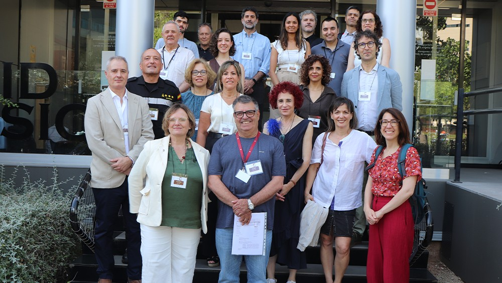
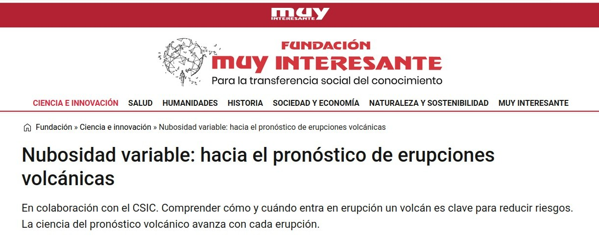
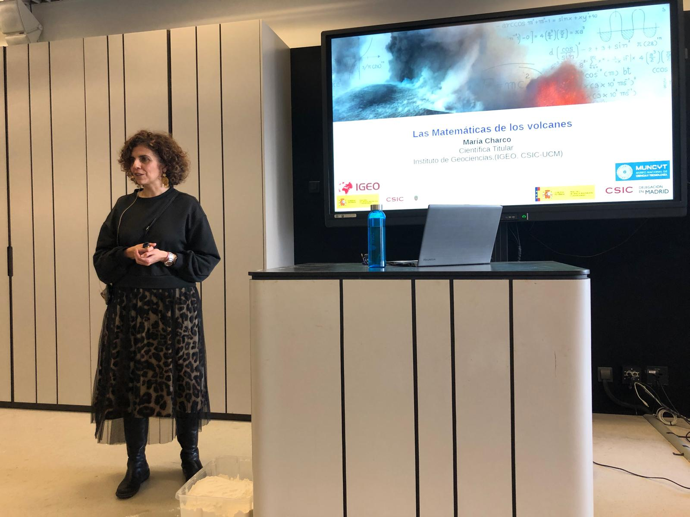
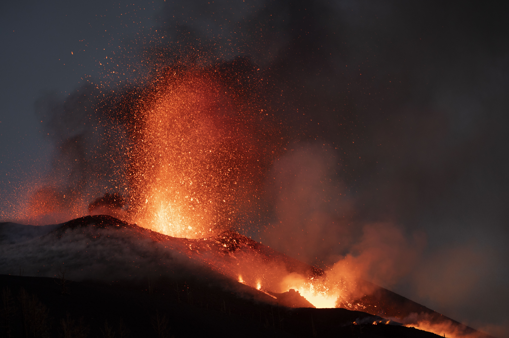
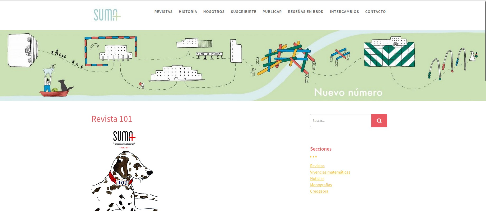
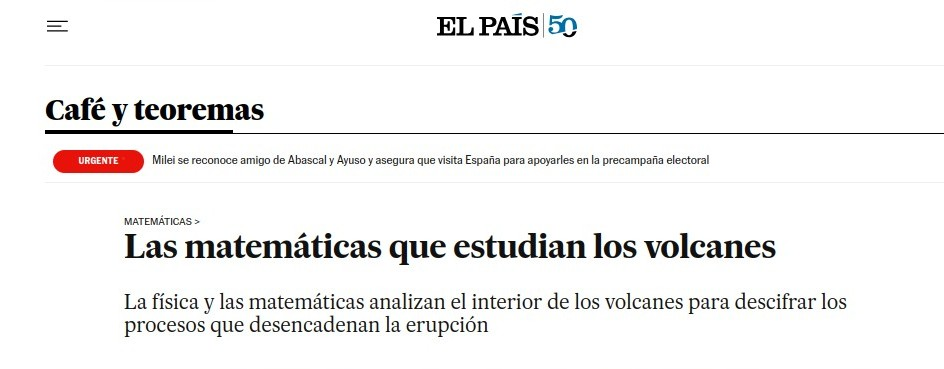

## 2026

### Itinerario Ciceron-CSIC: "Evaluación y gestión de los riesgos naturales y su impacto ambiental"

Lugar:Instituto de Diagnóstico Ambiental y Estudios del Agua (IDAEA-CSIC) .Fecha: 17/06/2026

{fig-align="center" width="70%"}

Participación en la Jornada de los itinerarios Ciceron "Evaluación y gestión de los riesgos naturales y su impacto ambiental" (programa Converge- CSIC) [web de la noticia](https://converge.csic.es/el-idaea-y-el-igme-celebran-un-nuevo-itinerario-ciceron-para-abordar-la-gestion-y-el-impacto-ambiental-de-los-riesgos-naturales/) y presentación de proyectos y líneas de investigación relacionadas con "Gemelos Digitales en Volcanología".

[Ver video →](https://www.youtube.com/watch?v=oUEGl8UGuuw){.btn .btn-outline-primary .btn-sm}

### Nubosidad variable: hacia el pronóstico de erupciones volcánicas

Medio: Fundación Muy Interesante · Fecha: 2/01/2026

{fig-align="center" width="70%"}

Divulgación científica en la revista Muy Interesante sobre el pronóstico de erupciones volcánicas. Junto con Pablo J. González (IPNA-CSIC), artículo de divulgación sobre el estado actual de la ciencia del pronóstico de erupciones volcánicas en la [web de Muy Interesante](https://www.fundacionmuyinteresante.org/pronostico-erupciones-volcanicas-claves-y-metodos.html).

[Leer artículo →](https://www.fundacionmuyinteresante.org/pronostico-erupciones-volcanicas-claves-y-metodos.html){.btn .btn-outline-primary .btn-sm}

## 2025

### Ciclo Ciencia en Primera Persona: "Las Matemáticas de los volcanes"

Lugar: Museo Nacional de Ciencia y Tecnología (MUNCYT) · Fecha:09/03/2025

{fig-align="center" width="70%"}

Charla divulgativa en la novena edición del ciclo de conferencias "Ciencia en Primera Persona" organizado por el MUNCYT en colaboración con el CSIC [web de la actividad](https://www.muncyt.es/actividades/las-matematicas-de-los-volcanes?type=actividades).

[Ver Conferencia →](https://www.youtube.com/watch?v=Q_b8Bt6gLI4){.btn .btn-outline-primary .btn-sm}

## 2024

### Nota de Prensa sobre el trabajo Charco et al. (2024)

Medio: CSIC· Fecha: 30/05/2024

{fig-align="center" width="70%"}

Un estudio del CSIC abre nuevos caminos para pronosticar la duración de futuras erupciones volcánicas. [Nota de prensa en la web del CSIC](https://www.csic.es/es/actualidad-del-csic/un-estudio-del-csic-abre-nuevos-caminos-para-pronosticar-la-duracion-de-futuras-erupciones-volcanicas).

[Leer nota de prensa →](https://www.csic.es/es/actualidad-del-csic/un-estudio-del-csic-abre-nuevos-caminos-para-pronosticar-la-duracion-de-futuras-erupciones-volcanicas){.btn .btn-outline-primary .btn-sm}

## 2023

### Cuadernillo del Día Escolar de las Matemáticas (2023)

Medio: Nº 101 de la Revista SUMA. Fecha. 12/05/2023

{fig-align="center" width="70%"}

Cuadernillo de actividades educativas realizado por invitación de la "Federación Española de Sociedades de Profesores de Matemáticas (FSPM)" en el número 101 de la Revista SUMA [Web de SUMA](https://revistasuma.fespm.es/revistas-revistas/revista-101.html).

[Ir al cuadernillo de actividades →](https://revistasuma.es/wp-content/uploads/suma/Suma101/DEM-2023.pdf){.btn .btn-outline-primary .btn-sm}

## 2021

### Noticia en el periódico EL PAÍS

Medio: EL PAÍS Digital· Fecha: 28/09/2021

{fig-align="center" width="70%"}

Publicación de la noticia "Las matemáticas que estudian los volcanes" realizada en colaboración con Ágata A. Timón (ICMAT) en la sección "Café y Teoremas" del diario "El País" a raíz de mi participación en el análisis de datos geodésicos durante la erupción de Tajoaite (La Palma, 19/09/2021-13/12/2021). 

[Leer noticia en "El País" →](https://elpais.com/ciencia/cafe-y-teoremas/2021-09-28/las-matematicas-que-estudian-los-volcanes.html){.btn .btn-outline-primary .btn-sm}